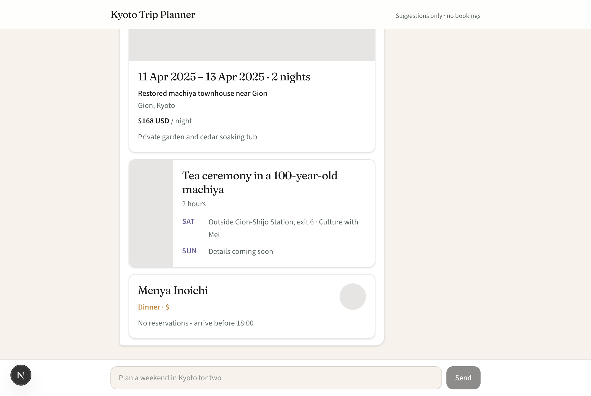

# Kyoto Trip Planner

Chat prototype that suggests a **stay**, **experience**, and **meal** for a two-night weekend in Kyoto. Suggestions only — no bookings.



## What’s included

- Header, scrolling thread, and locked send box while the assistant “thinks”
- Pulsing dots in the reply bubble before cards appear
- Mock reply from one row per sheet of the *Kyoto Weekend Prototype Content Pack* (Stays S1, Experiences E1, Food F1), with filler text for empty fields
- Three separate card layouts:
  - **Stay** — wide banner, dates as the largest text, coral accent
  - **Experience** — tall left strip, activity name largest, purple day labels
  - **Food** — round thumbnail top-right, restaurant name largest, amber meal/price label
- Forced error path: open `/?fail=once`, send a trip request, then tap **Try again**

## Run locally

```bash
npm install
npm run dev
```

Open [http://localhost:3000](http://localhost:3000) and send: `Plan a weekend in Kyoto for two`.
