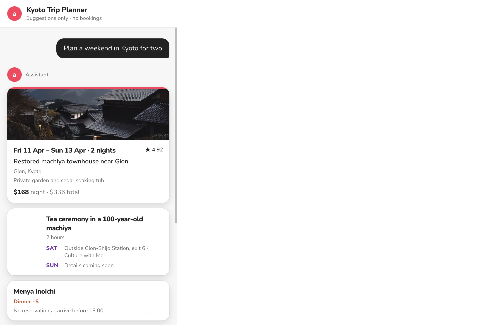
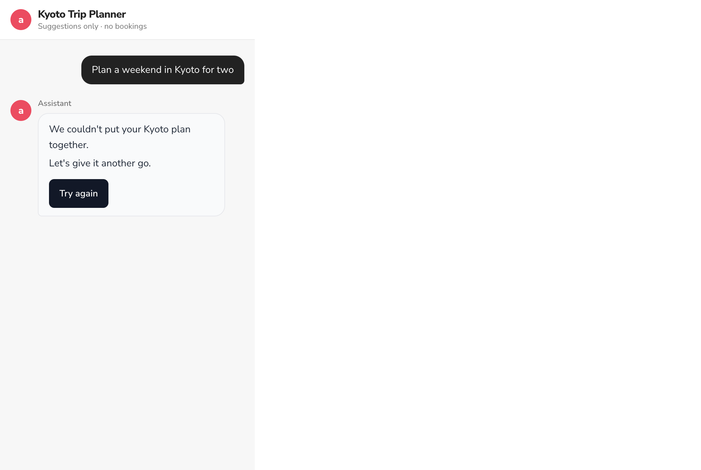
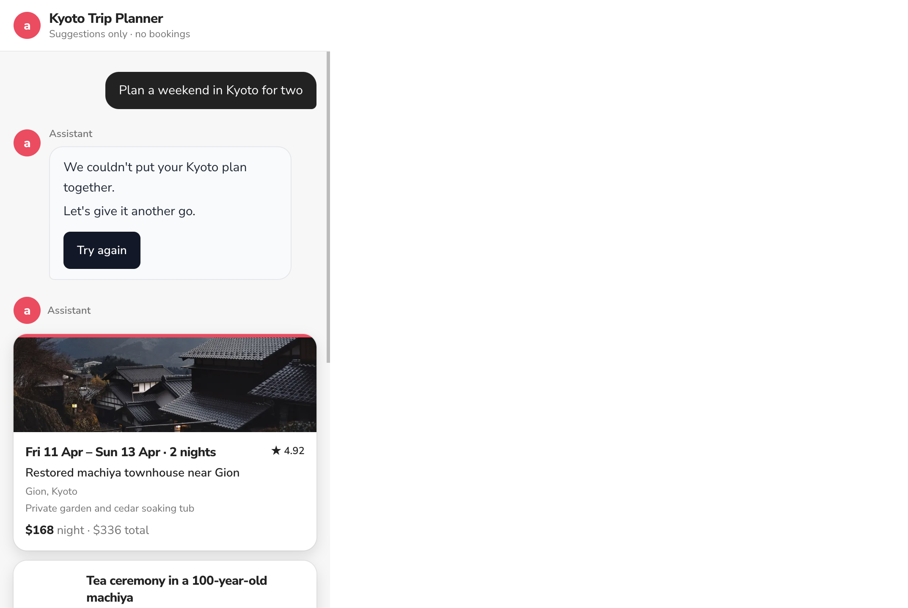
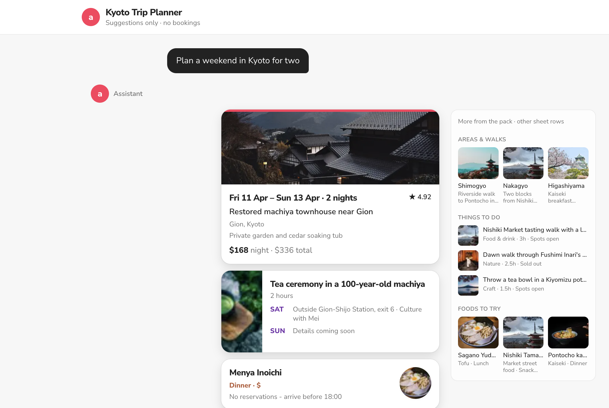
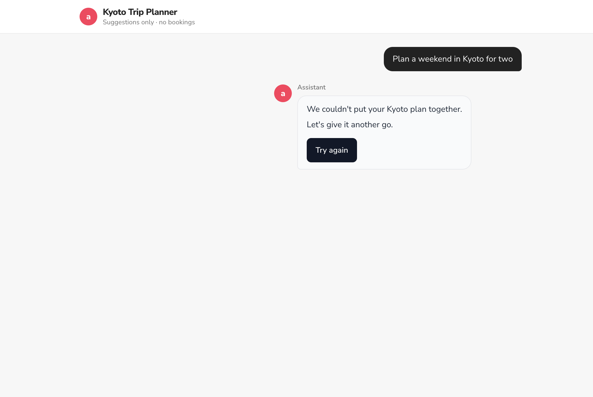
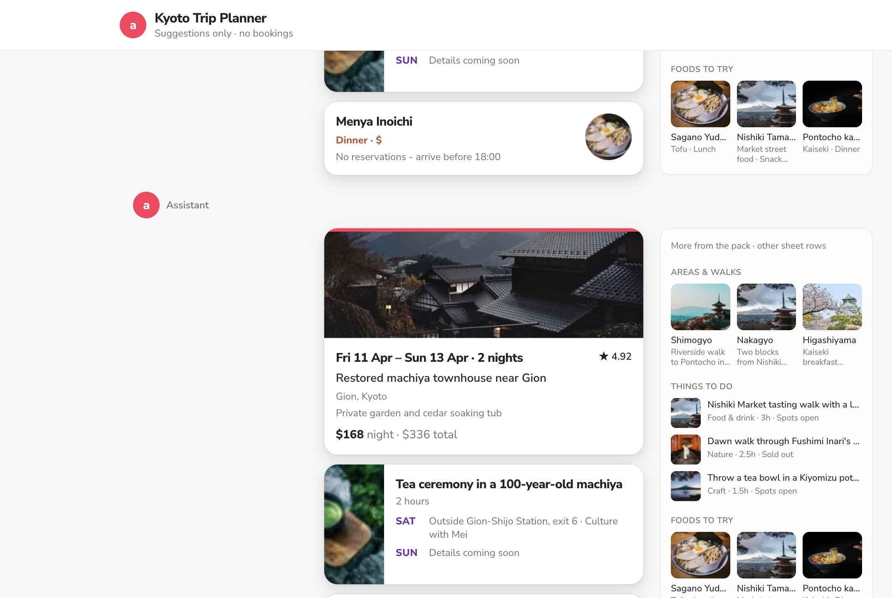

# Live link

**https://kyoto-chat.vercel.app**

# Kyoto Trip Planner

Chat prototype that suggests a **stay**, **experience**, and **meal** for a two-night weekend in Kyoto. Suggestions only — sample data, nothing is booked.

## Moderated session checklist

Rules from *Moderated Session Prototype Requirements: Trip-Planner Chat*, verified in a private/incognito window on phone (~390px) and laptop (~1440px).

| Rule | Phone | Laptop |
|---|---|---|
| Opens with no install, login, or configuration | [x] | [x] |
| Visible wording that trips are sample data and nothing is booked | [x] | [x] |
| One trip request shows thinking, then 3 of 3 cards (stay, Experience, food) with clearly different layouts | [x] | [x] |
| At phone width, nothing cut off and no sideways scroll | [x] | — |
| Forced failure shows a friendly message and Try again in the assistant bubble | [x] | [x] |
| Zero blank-chat moments (failure, Try again press, and after) | [x] | [x] |
| Try again brings the three cards back | [x] | [x] |

### Evidence screenshots

| Setup | Cards | Error bubble | Cards after retry |
|---|---|---|---|
| Phone |  |  |  |
| Laptop |  |  |  |

## Team message (#search-trip-planner)

Kyoto Trip Planner is ready for the dry run (Thu 13 Mar) and guest sessions (1 Apr). Live: https://kyoto-chat.vercel.app — no login. Happy path: type “Plan a weekend in Kyoto for two”. Forced failure: open https://kyoto-chat.vercel.app/?fail=once, send the same request, tap Try again (no code edits). Suggestions only — sample data, nothing booked. cc Hannah Brooks, Tomás Herrera, Priya Raman, Daniel Okafor.

## Forced failure

Open [`/?fail=once`](https://kyoto-chat.vercel.app/?fail=once), send a trip request, then tap **Try again** to see the three cards.

## What’s included

- Header, scrolling thread, and locked send box while the assistant “thinks”
- Pulsing dots in the reply bubble before cards appear
- Mock reply from one row per sheet of the *Kyoto Weekend Prototype Content Pack* (Stays S1, Experiences E1, Food F1), with filler text for empty fields
- Broken mock payload wired to `?fail=once`; the parser cannot turn it into cards, so the friendly error bubble appears
- Three separate card layouts (stay, experience, food) plus a quiet workbook explore rail
- **Try again** resends the same request and skips the broken answer

## Run locally

```bash
npm install
npm run dev
```

Open [http://localhost:3000](http://localhost:3000) and send: `Plan a weekend in Kyoto for two`.
