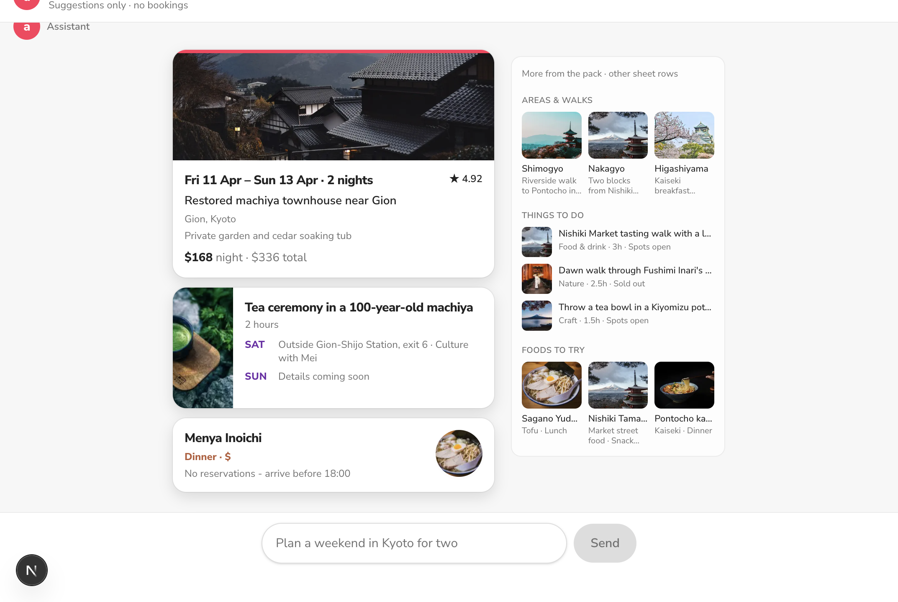
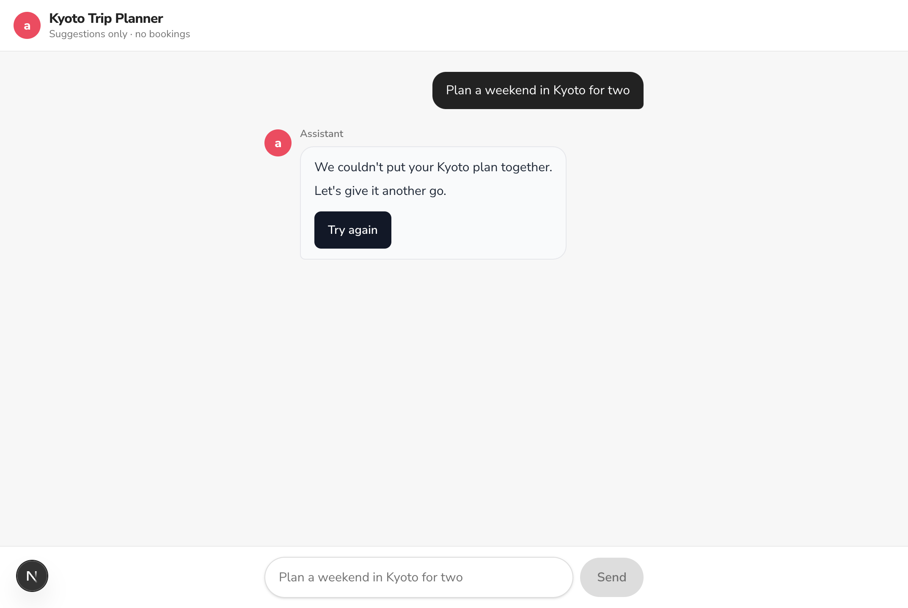

# Kyoto Trip Planner

Chat prototype that suggests a **stay**, **experience**, and **meal** for a two-night weekend in Kyoto. Suggestions only — no bookings.



## Forced failure

Open [`/?fail=once`](http://localhost:3000/?fail=once), send a trip request, then tap **Try again** to see the three cards.



## What’s included

- Header, scrolling thread, and locked send box while the assistant “thinks”
- Pulsing dots in the reply bubble before cards appear
- Mock reply from one row per sheet of the *Kyoto Weekend Prototype Content Pack* (Stays S1, Experiences E1, Food F1), with filler text for empty fields
- Broken mock payload wired to `?fail=once`; the parser cannot turn it into cards, so the friendly error bubble appears
- Three separate card layouts (stay, experience, food) plus a quiet workbook explore rail
- **Try again** resends the same request and skips the broken answer

## Run locally

```bash
npm install
npm run dev
```

Open [http://localhost:3000](http://localhost:3000) and send: `Plan a weekend in Kyoto for two`.
